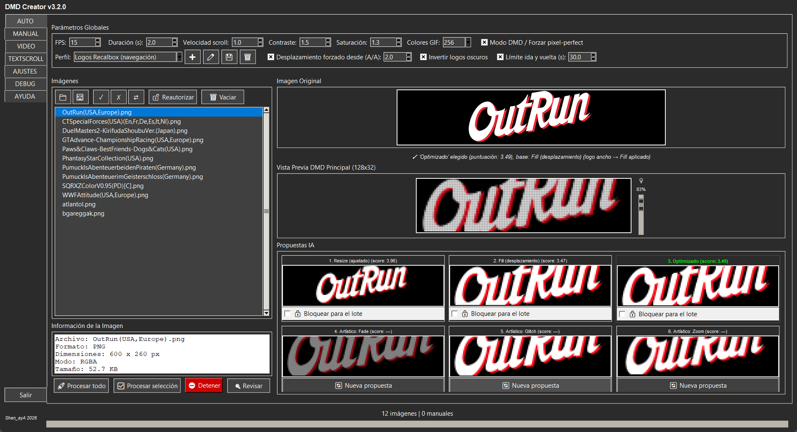
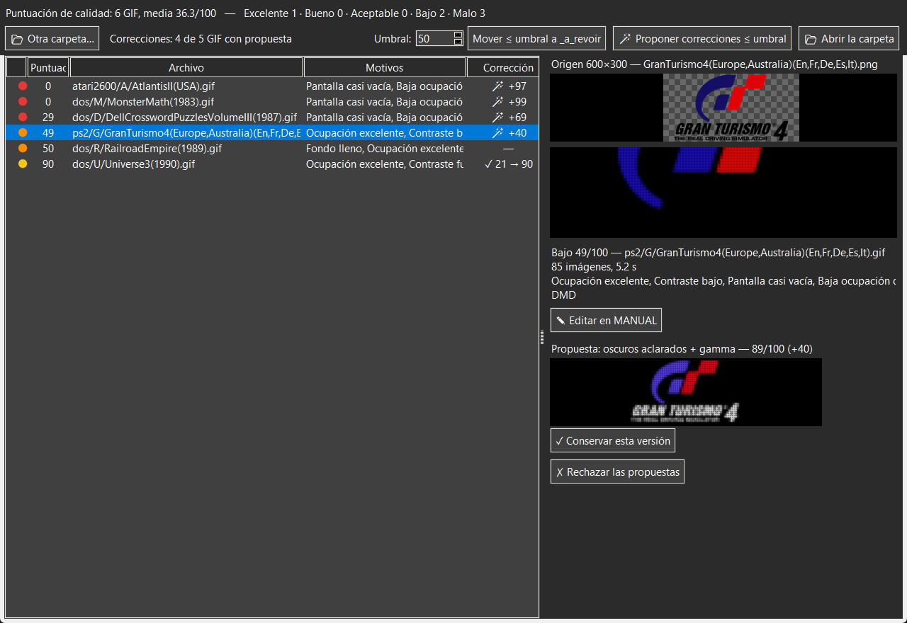
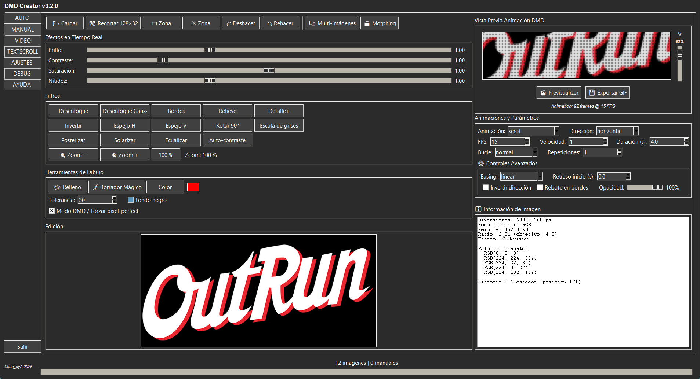
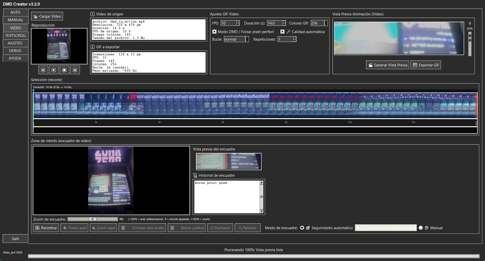
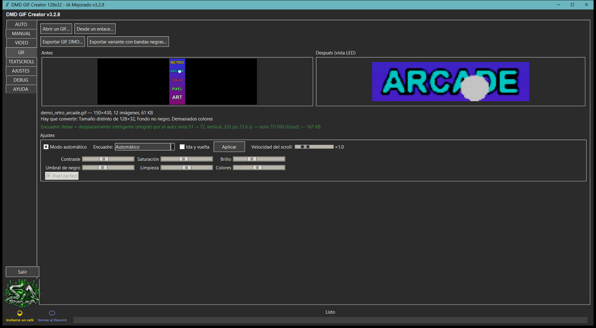
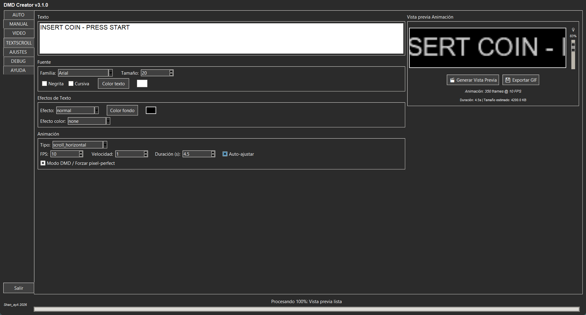

[🇫🇷 Français](./README.md) · [🇬🇧 English](./README_EN.md) · 🇪🇸 **Español**

# DMD GIF Creator 128x32 — v3.2.8

Cree GIF optimizados para pantallas DMD 128×32 (máquina arcade, pinball,
[RecalBox DMD](https://github.com/shan-aya/RecalBoxDMD)) a partir de **imágenes**, de
un **vídeo**, de un **GIF existente** o de **texto animado**, con análisis automático, edición manual avanzada y
procesamiento por lotes de carpetas enteras.

(Antes « DMD GIF Converter ».)

👉 **[Página de presentación del proyecto](https://shan-aya.github.io/DMD_GIF_creator/)**

## Descarga

**Windows**: descargue `dmd_gif_creator_v328.exe` desde la
[última Release](https://github.com/shan-aya/DMD_GIF_creator/releases/latest) y
ejecútelo — no hace falta instalar nada.

El ejecutable no está firmado: Windows SmartScreen puede pedir una confirmación en el
primer inicio («Más información» y luego «Ejecutar de todas formas»). Si un antivirus lo
bloquea durante un procesamiento por lotes (protección anti-ransomware), es un falso
positivo: vea «Antivirus» en la [guía](./NOTICE_ES.md#buenas-prácticas-y-limitaciones-conocidas).

**Desde las fuentes** (carpeta [`dmd_gif_creator/`](./dmd_gif_creator)):

    pip install pillow numpy tkinterdnd2 markdown opencv-contrib-python
    python dmd_gif_creator/dmd_gif_creator_v328.py

`opencv-contrib-python` (y no `opencv-python`) es necesario para el seguimiento
automático de la pestaña VIDEO; los dos paquetes no deben instalarse a la vez.

## Qué hace la aplicación

### AUTO — una imagen, seis propuestas

Arrastre y suelte imágenes o carpetas enteras (PNG, JPG, BMP, GIF, raw565). Para cada
imagen, la aplicación calcula dos renders 128×32 — **Resize** (la imagen entera
reducida) y **Fill** (la imagen más grande, con desplazamiento) — y los puntúa según
la ocupación de la pantalla y la legibilidad. Se conserva el mejor y luego se afina
(limpieza, pixel-perfect). Tres variantes artísticas completan las seis propuestas;
la vista previa LED (con lupa) muestra el render real del panel.

Un **perfil** adapta esta elección al uso: **Genérico** (sin límites), **Logos
Recalbox** (se impone el desplazamiento a los logos anchos, una ida y vuelta dura como
máximo 30 s, 15 i/s) o **DMD playlist** (20 i/s para mayor fluidez). Puede crear sus
propios perfiles en una página donde cada parámetro está explicado. Los logos oscuros
sobre fondo transparente, invisibles en un DMD negro, se invierten cuando el render
mejora.

El **procesamiento por lotes** aplica el mismo análisis a cada imagen de una carpeta —
por ejemplo todos los logos scrapeados de una ludoteca: cada logo recibe el modo de
render que le conviene, en paralelo, conservando el árbol de carpetas y sin modificar
nunca los archivos de origen. Una propuesta puede bloquearse para todo el lote. Cada
GIF recibe una **puntuación de calidad**, y la ventana **Revisar** lista primero los
más bajos, con vista previa e imagen de origen, para revisar rápidamente miles de logos
y apartar (sin borrar nunca) los fallidos. **Propone correcciones** para los GIF bajos
(texto negro aclarado, vacío eliminado, gamma, inversión…), que se validan una a una, o
abre el origen en MANUAL para rehacerlo a mano.

### MANUAL — edición avanzada

Recorte 128×32 con un marco que se desplaza, zona que limita los efectos a una parte de
la imagen, brillo, contraste, saturación, nitidez, filtros, zoom de la animación, relleno
y goma mágica, animaciones (desplazamiento, zoom, fundido…) con easing y bucle,
multi-imágenes y morphing, historial deshacer/rehacer.

### VIDEO — un GIF a partir de un vídeo

Elija un fragmento de un vídeo (MP4, MOV, AVI, MKV, WEBM, WMV, FLV, MPG, TS, 3GP, OGV…)
en la línea de tiempo y luego el
encuadre: seguimiento automático de un sujeto, encuadre automático con zoom o puntos
manuales (zona y zoom que evolucionan en el tiempo). La calidad automática ajusta
contraste, saturación y brillo según el vídeo, y el peso del GIF se estima en directo.

### GIF — convertir un GIF existente

Abra (o arrastre) un GIF animado, aunque sea grande o tenga un formato inadecuado: la pestaña lo convierte en un GIF DMD 128×32 conservando sus duraciones, con una vista previa LED antes/después. En **modo automático** la aplicación elige sola entre la imagen completa con bandas negras y un **desplazamiento a pantalla completa**, según la nota de calidad. Con **Rellenar**: **desplazamiento inteligente** (eje, sentido y velocidad adaptados al contenido, pausas en los extremos, ida y vuelta, control de velocidad) o **marco 128×32 manual** (inicio y fin con el ratón). El mismo motor sirve al bot del servidor de Discord (`/gif`).

### TEXTSCROLL — texto animado

Fuente, tamaño, colores, efectos de texto y de color, y numerosas animaciones
(desplazamiento horizontal o vertical, ola, Star Wars, máquina de escribir, lluvia
Matrix, glitch…), con una duración ajustada automáticamente a la longitud del texto.

### Además

- **AJUSTES**: valores por defecto, idioma (francés, inglés, español).
- **DEBUG**: registro detallado y filtrable.
- **AYUDA**: la guía completa dentro de la aplicación.

## Novedades

**v3.2.8**
- **Nueva pestaña GIF**: convierte un GIF animado existente en un GIF DMD 128×32, conservando sus duraciones. Modo **automático** (elige solo entre la imagen completa y un desplazamiento a pantalla completa, según la nota de calidad) o ajustes manuales, encuadre automático / seguimiento del sujeto / bandas negras / rellenar, vista previa LED antes/después, exportación del GIF y de la variante con bandas negras.
- **Desplazamiento inteligente**: eje, sentido y velocidad adaptados al contenido, pausas en los extremos, **ida y vuelta** sin salto al repetir, control de **velocidad** (×0,5 a ×3).
- **Marco 128×32 manual**: un marco **Inicio** (y **Fin** con el desplazamiento) colocado con el ratón sobre la vista previa, vista LED actualizada mientras arrastra.
- **Desde un enlace…** e inicio con `--open <GIF o dirección>`: abre la pestaña GIF con el GIF precargado.
- Cabecera de la ventana: «DMD GIF Creator» (ya no «DMD Creator»).
- En el servidor de Discord, el comando **`/gif`** usa este mismo motor: envíe un GIF de cualquier tamaño, el bot lo convierte, el equipo lo valida y lo publica.

**v3.2.7**
- **Marca de agua invisible «DGC»**: los GIF creados por la aplicación llevan una marca invisible (imperceptible, ±1/255 por color) que permite saber que proceden de DMD GIF Creator. Un botón **🔍 Verificar un GIF…** (pestaña AJUSTES) indica si un GIF o un archivo raw565 la lleva. Es un indicio, no una prueba.
- **Enlace al servidor de Discord de ayuda** (FR/EN) al pie de la ventana, junto al icono ☕.

**v3.2.6**
- **Logo Shan_ayA y enlace de apoyo**: el logo aparece al final de la columna de pestañas (el botón
  « Salir » sube para dejarle sitio) y el texto « Shan_ayA 2026 » se sustituye por el icono ☕
  « Invítame un café », con un globo al pasar el ratón; un clic abre la página de Buy Me a Coffee.

**v3.2.5**
- **Pixel-perfect: logotipos a tamaño completo**: cuando el divisor entero reducía la imagen
  en más de un 3 % respecto al marco (por ejemplo 60×30 en lugar de 64×32), la reducción se
  hace ahora a la escala exacta: cada LED es el promedio exacto de su bloque de píxeles, con
  la misma cantidad de luz que el original y sin perder ninguna fila ni columna de LED. En el
  desplazamiento, el eje fijo ocupa toda la altura (o la anchura) sin desbordar nunca.
- Pestaña **AUTO**: los tres botones de selección de la lista de imágenes (seleccionar todo,
  deseleccionar todo, invertir) tienen ahora ayuda al pasar el ratón.

**v3.2.4**
- **Zona de progreso legible**: el nombre del archivo en curso está centrado sobre la
  barra y el porcentaje en el centro de la barra; ya no hay texto que cambia de ancho y
  hace moverse toda la zona.
- **Botón Detener** (lote): reacciona de inmediato en lugar de esperar al final de la
  imagen en curso; si un proceso de cálculo se detiene, el lote lo indica en lugar de
  quedarse bloqueado en silencio.

**v3.2.3**
- **Pantallas grandes** (4K, escala de pantalla del 125 % o más, ventana maximizada): las
  vistas previas crecen con la ventana en todas las pestañas y en la ventana Revisar, en
  lugar de quedarse pequeñas en medio de grandes marcos vacíos.
- Pestaña **VIDEO**: la generación ya no guarda el vídeo en memoria (32 s de 1080p:
  3,4 GB → 0,5 GB), mismo GIF.
- **Pixel-perfect** en VIDEO: sin banda negra alrededor de la imagen cuando la zona o el
  zoom de encuadre no encaja exactamente.

**v3.2.2**
- Pestaña **VIDEO** mucho más rápida y ligera: generación del GIF hasta 7 veces más rápida
  en 1080p, repartida en varios núcleos; el reproductor ya no decodifica en segundo plano.
- **Vídeo largo**: se propone recortar un fragmento justo después de elegirlo, con la
  memoria necesaria mostrada; alerta si un fragmento es demasiado largo para la memoria.

**v3.2.1**
- Los cálculos del procesamiento por lotes se ejecutan con **prioridad baja**: el PC
  sigue utilizable durante un lote, sin pérdida de velocidad cuando está libre.
- **AJUSTES**: número de núcleos usados por el lote (Auto por defecto).
- Información de versión en el ejecutable; nota «Antivirus» en la guía.

**v3.2.0**
- Ventana **Revisar**: **correcciones propuestas** para los GIF bajos (vacío eliminado,
  partes oscuras aclaradas, gamma, niveles, inversión), con vista previa LED y validación
  una a una; el original se aparta, nunca se borra. Miniatura de la imagen de origen,
  botón **Editar en MANUAL**, paso al GIF siguiente tras validar.
- **MANUAL**: **zona** que limita controles y filtros a una parte de la imagen, **zoom**
  de la animación (50 a 300 %), recorte 128×32 con un **marco que se desplaza**.
- **VIDEO**: se aceptan además los formatos WEBM, M4V, WMV, FLV, MPG/MPEG, TS, 3GP y OGV.
- Correcciones: los controles de MANUAL ya no deshacen un recorte o un filtro; vistas
  previas a la velocidad correcta; propuestas 4 a 6 de AUTO de nuevo visibles.

**v3.1.0**
- **Puntuación de calidad** de cada GIF y ventana **Revisar** (del más bajo al mejor,
  vista previa LED, apartado sin borrar).
- **Perfiles**: Genérico, Logos Recalbox, DMD playlist y perfiles personales.
- **Logos oscuros** sobre fondo transparente invertidos cuando el render mejora.
- El ajuste «Seuil lettrage» (umbral de letras) se sustituye por la opción de perfil
  «Desplazamiento forzado desde (A/A)».

**v3.0.2**
- Pestaña AUTO totalmente traducida al inglés y al español (nombres de las
  propuestas, línea de estado, barra de estado).

**v3.0.1**
- Procesamiento por lotes unas **2,4 veces más rápido**: hasta 12 imágenes en paralelo
  según el procesador, y codificación GIF acelerada.
- Traducción más completa de la interfaz al inglés y al español.

**v3.0**
- Pestaña **VIDEO**, pestaña **AYUDA**, **arrastrar y soltar** en cualquier lugar de la
  ventana.
- **Vista previa LED** en todas las pestañas de creación.
- Procesamiento por lotes en paralelo, carpetas de decenas de miles de imágenes
  cargadas sin congelar la ventana.
- Formato raw565 como entrada, deshacer/rehacer en MANUAL, ayudas emergentes.

Historial completo (en francés): [CHANGELOG_FR](./CHANGELOG_FR)

## Documentación

Guía completa: [🇫🇷 Français](./NOTICE_FR.md) · [🇬🇧 English](./NOTICE_EN.md) ·
[🇪🇸 Español](./NOTICE_ES.md) — también disponible dentro de la aplicación, pestaña
**AYUDA**.

---

## 🤝 Agradecimientos

- [RetroPixelLED original](https://github.com/fjgordillo86/RetroPixelLED)
- [red77290/dmd_gif_converter](https://github.com/red77290/dmd_gif_converter) (MIT):
  idea de la puntuación de calidad y del apartado de los GIF bajos
- Visual Studio Code
- [Sixth](https://trysixth.com/)

## ☕ Apoyar el proyecto

Si este proyecto te ha ayudado, puedes invitarme a un café:
👉 [☕ Buy Me a Coffee](https://buymeacoffee.com/shan_aya)
👉 [☕ Donate via PayPal](https://www.paypal.com/paypalme/felysaya)

## Contacto

Para cualquier pregunta, sugerencia o contribución, abra un issue o contacte con el
autor Shan_ayA.

---

© 2026 Shan_ayA
